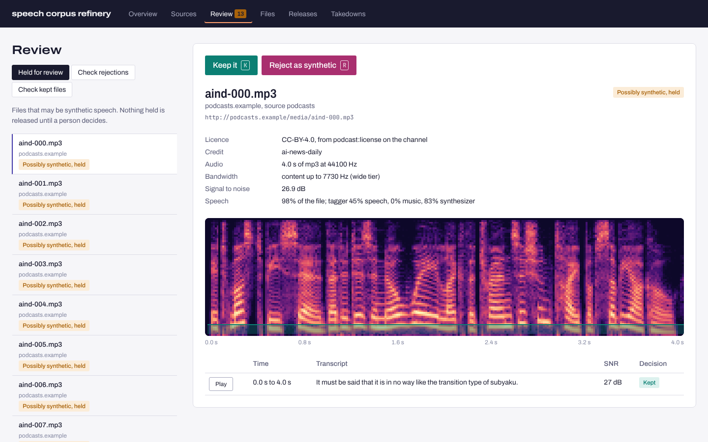
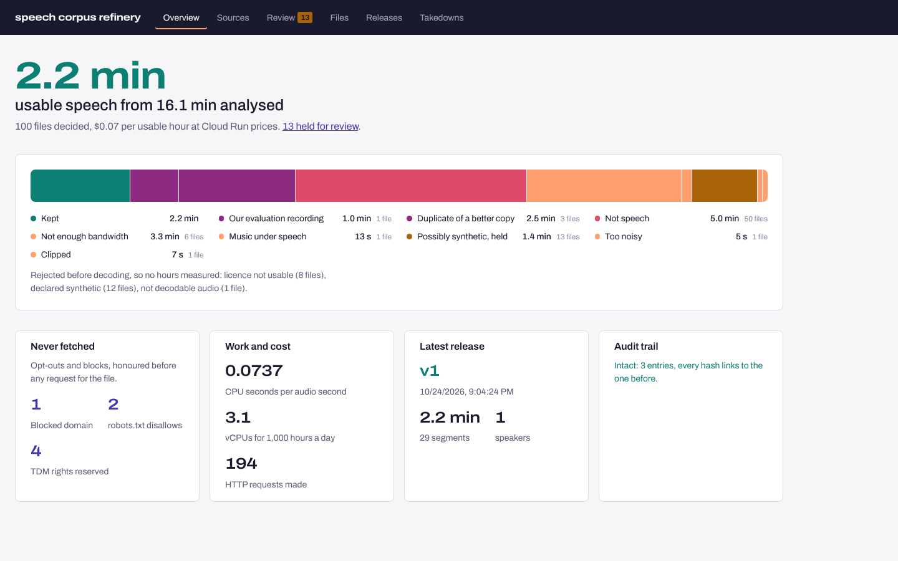
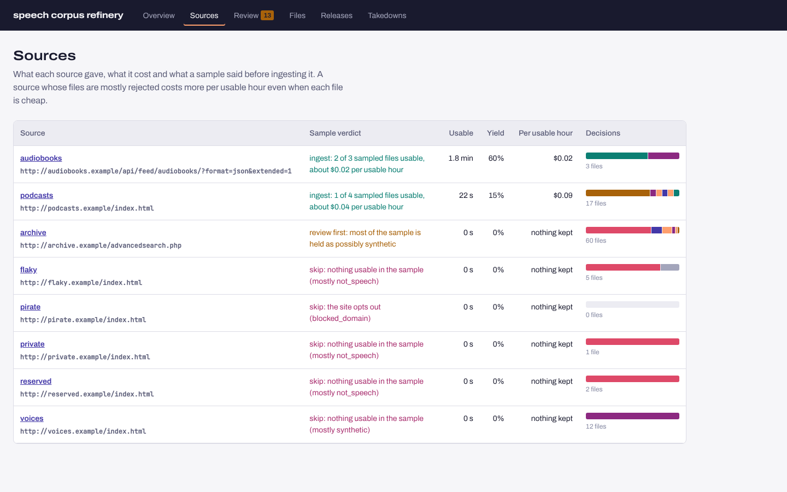
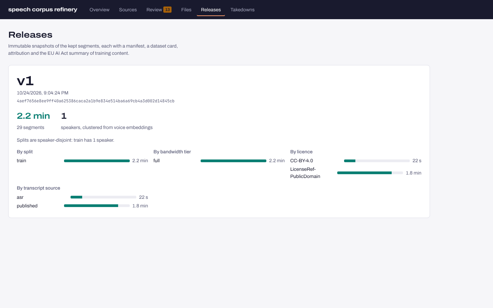
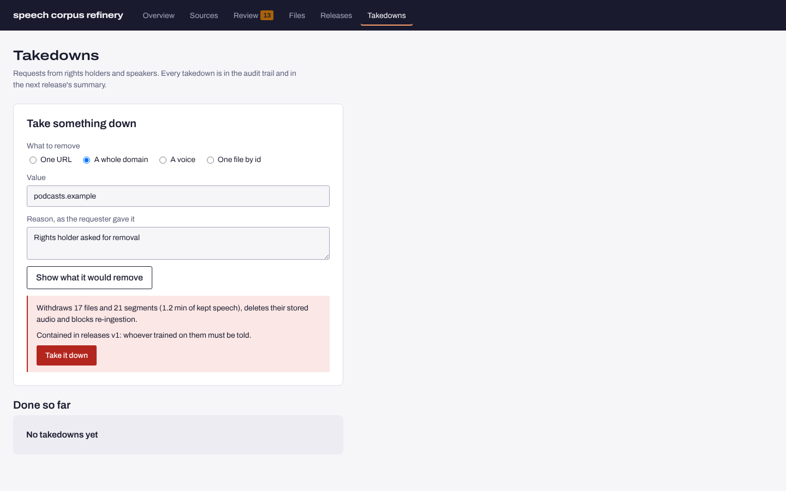

# speech-corpus-refinery

Turns the open web's speech into text-to-speech training data you are allowed to use, and tells
you what each usable hour cost.

It finds sources (LibriVox, the Internet Archive, podcast feeds, ordinary sites with schema.org
metadata), scores each one on a sample before crawling it, and crawls politely. Every opt-out is
checked before a byte is fetched: the piracy blocklist, takedowns, robots.txt and all three
TDMRep signals. Each file's licence and any AI-generated declaration are checked before it is
decoded. Then it refines what is left:

- bandwidth tiers (HiFiTTS-2), SNR, clipping, speech/music/synthetic tagging, language;
- segmentation, ASR aligned to the published text, speaker embeddings;
- fingerprint deduplication that also catches excerpts and copies up to 10% faster or slower,
  and keeps the better copy.

What comes out are immutable releases with speaker-disjoint splits, attribution and an EU AI Act
training-content summary. A takedown can pull a recording, a domain or a voice back out.

Quality is not taken on trust. Besides the dev world it was built against, it is measured on
test worlds written **blind**, from the policy alone, by someone who never saw the code. Each
blind world's first run is committed and never edited.



## Results

Every number here is produced by the code in this repository: `scr demo`,
`reports/heldout/*/`, and `scripts/measure_*.py`.

| | |
|---|---|
| **Dev world** (110 files, 8 sites) | **109 of 110** right; the miss is a clean studio recording held as possibly synthetic ([why](docs/adr/0004-undeclared-synthetic-speech-is-held.md)) |
| **Blind worlds, first run** (never rewritten) | set1 **43/50** · set2 **50/56** · set3 **48/59** · set4 **50/55** |
| Same worlds after the fixes they prompted (all four are regression sets now) | set1 46/50 · set2 52/56 · set3 48/59 · set4 52/55 |
| **Rights**, from the test servers' own request logs | **0** requests to blocked domains, robots-disallowed paths or `tdmrep.json`-reserved paths; **0** header/meta-reserved files stored, on every world |
| Synthetic speech, dev world | declared: 12 of 12 rejected before decoding; undeclared: 12 of 12 held for review, none kept |
| Transcripts of kept segments, dev world | CER **0.016** where the source publishes its text (aligned) vs 0.137 for raw ASR; 97% of true speech covered |
| **Cost** | **$0.06–0.07 per usable hour** across reruns (measured CPU at Cloud Run job prices); ASR is the largest stage; 1,000 h of audio a day needs about 3 vCPUs |
| Clipping probe, 240 flac/mp3/ogg files | 76 misjudged → **4**, all within a factor of two of the limit ([measurements](docs/MEASUREMENTS.md)) |
| Tests | 98 Python tests (unit, PostgreSQL, API roles, crawler against the test world, infrastructure invariants, 6 end to end) and 19 console tests, all passing |

### What the blind worlds found

Each blind world found something the dev world did not. The fixes are measured, and what could
not be fixed is written down.

| World | Found | Done |
|---|---|---|
| set1 | Noisy re-uploads ranked above clean originals; sped-up copies missed | Copies ranked by bandwidth *tier*, then SNR, then bitrate; speed search ±10% by rescaling fingerprint peaks |
| set2 | mp3 coding hid clipping completely (measured 0 at +12 dB) | Clipping measured as the share of samples near full scale, which survives lossy coding |
| set2 | A clean 2.6 s file with no pauses read 24.7 dB SNR | Two alternative estimators measured; both worse. Documented as a limit |
| set3 | A better-looking copy demoted the clean one and was then rejected itself (clipped), so neither copy was kept | The better copy demotes others only once it is kept, and orphaned duplicates are re-queued |
| set4 | A clean 6 s quote outranked the full recording it came from, and half the audio was lost | Coverage first: an excerpt never replaces the fuller recording |

Still missed, and documented in [MEASUREMENTS.md](docs/MEASUREMENTS.md):
- music beds 24 dB or more under the speech (caught 4 of 4 at 12–18 dB, 0 of 5 at 24–36 dB);
- an undeclared TTS voice the tagger does not recognise;
- bandwidth within ±0.5 kHz of 7 kHz;
- clean studio speech held as possibly synthetic (held, not lost).

## How it works

```
 sources ─▶ discover (sample, score: yield, reasons, $ per usable hour) ─▶ seed
                                                                          │
 frontier (PostgreSQL) ◀──────────────────────────────────────────────────┘
   │ per-host lease, ≥1 s apart, Retry-After, 24 h robots cache
   ├─ blocked domain? takedown? ─────────────────▶ never contacted
   ├─ robots.txt (RFC 9309) · tdmrep.json ───────▶ never requested
   ├─ tdm-reservation header ────────────────────▶ body not read
   ├─ <meta tdm-reservation> ────────────────────▶ page not used
   └─ audio ─▶ GCS blob (content-addressed) ─▶ analyse job
                                                │ leased by parallel workers (SKIP LOCKED)
 analyse: licence / AI declaration ─▶ decode ─▶ bandwidth · VAD · SNR
          ─▶ fingerprint (±10% speed): takedown? protected eval set? better copy elsewhere?
          ─▶ speech / music / synthesizer tags · language
          ─▶ segments 1.5–20 s: SNR · clipping · ASR · alignment to published text · speaker
          ─▶ kept │ held for review │ rejected (reason)          one transaction, idempotent
                                                │
 release ─▶ speakers clustered across sources ─▶ speaker-disjoint splits ─▶ FLAC WebDataset
            shards + Parquet manifest + CARD + ATTRIBUTION + AI Act summary   (immutable)
 takedown ─▶ withdraw · delete blobs · list releases · do-not-crawl · block fingerprint/voice
```

- **[Data policy](docs/POLICY.md):** what may be collected and what may train a model, in plain
  words. `config/rights.yaml` and `config/settings.yaml` hold the same rules as data. No
  threshold lives in code.
- **[Crawler identity](docs/CRAWLER.md):** how ScrBot behaves and how to keep it out.
- **Decisions:**
  [PostgreSQL as queue and record](docs/adr/0001-postgres-is-the-queue-and-the-record.md),
  [rights before bytes](docs/adr/0002-rights-before-bytes.md),
  [duplicates](docs/adr/0003-duplicates-keep-the-better-usable-copy.md),
  [synthetic speech is held](docs/adr/0004-undeclared-synthetic-speech-is-held.md),
  [blind held-out worlds](docs/adr/0005-blind-held-out-worlds.md),
  [Cloud Run jobs and Terraform](docs/adr/0006-cloud-run-jobs.md).
- **[Measurements](docs/MEASUREMENTS.md):** how far each probe can be trusted.
- **[Runbook](docs/RUNBOOK.md):** deploy, add a source, failed jobs, takedowns, releases.

## The review console

`scr serve` serves the API and the console (React, TypeScript, Framer Motion). The console has:

- **Overview:** usable hours, where the rest went, and what was never fetched.
- **Sources:** discovery verdict, yield and cost per usable hour.
- **Review:** held files with spectrogram and segments; keep or reject with K and R. Spot
  checks of rejections and kept files are summarised with Wilson intervals.
- **Files:** every file, with its spectrogram and segments.
- **Releases.**
- **Takedowns:** previewed before they run.

Roles are viewer, reviewer and admin, via API keys. Every decision is in the hash-chained audit
log.

| | |
|---|---|
|  |  |
|  |  |

## Run it

Needs Python 3.11+, PostgreSQL 16 and Node 22 (for the console). Models and corpora are pinned
by sha256 and come from GitHub.

```bash
pip install -e ".[dev]"
createdb scr && createdb scr_test
scr fetch                                   # pinned models (sherpa-onnx, ~500 MB) and test corpora (~60 MB)
SCR_DATABASE_URL=postgresql:///scr scr demo # builds the dev world, discovers, crawls, refines, releases; ~7 min on 2 cores
(cd web && npm ci && npm run build)
SCR_AUTH=off SCR_DATABASE_URL=postgresql:///scr scr serve --port 8000   # console on http://127.0.0.1:8000
```

`docker compose up -d db api` does the same in containers. On real sources:

```bash
scr discover librivox librivox "https://librivox.org/api/feed/audiobooks/?format=json&extended=1" --sample 10
scr seed librivox librivox "https://librivox.org/api/feed/audiobooks/?format=json&extended=1"
scr crawl && scr work --processes 4 && scr release v1
```

## Deploy on GCP

[`infra/terraform`](infra/terraform) defines one image running as four Cloud Run jobs and one
service:
- `crawl`, nightly;
- `work`, hourly, as parallel tasks;
- `release`, by hand;
- `setup`, after each deploy;
- the API and console.

Around them:

- **Storage:** GCS for raw audio and releases. Raw audio has no soft delete, so a takedown
  really deletes. Releases are write-once, with versioning.
- **Database:** Cloud SQL PostgreSQL 16 on a private IP only, with PITR and backups.
- **Network:** Cloud NAT with one static address, so all crawler traffic is recognisable.
- **Secrets:** Secret Manager for the database URL and API keys.
- **Access:** a service account per job and no project-level roles. Only the takedown path can
  delete audio, through a custom role.
- **Operations:** Cloud Scheduler, and an alert on failed runs.

`tests/test_infra.py` checks these invariants in the Terraform itself. CI runs
`terraform validate`. It has not been applied to a live project, and the
[runbook](docs/RUNBOOK.md) has the steps.

## Tests

```bash
pytest -q -m "not slow"     # unit, PostgreSQL, API roles, crawler against the test world, infra invariants
pytest -q -m slow           # the whole pipeline end to end, then a takedown and a refused re-upload
cd web && npm test          # console: states, review actions by key, takedown preview, auth
python scripts/check_first_runs.py   # no held-out first run or world edited after the fact
```

CI (GitHub Actions) runs lint (ruff, mypy), both test suites against PostgreSQL, the console
(typecheck, lint, tests, build), `terraform validate`, the Docker build, and a weekly smoke test
of the LibriVox and Internet Archive connectors against the live services.

## Built on

- **Models:** [sherpa-onnx](https://github.com/k2-fsa/sherpa-onnx) for Silero VAD, Whisper tiny,
  CED-mini AudioSet tagging, WeSpeaker ResNet34 and Piper TTS.
- **Test corpora:** LJSpeech clips (public domain), the Free Spoken Digit Dataset (CC BY-SA 4.0),
  Valentini (CC BY 4.0) and ESC-50 clips under their own licences, all pinned by sha256 in
  [`config/assets.yaml`](config/assets.yaml).
- **Methods:**
  - HiFiTTS-2's bandwidth estimate ([arXiv:2506.04152](https://arxiv.org/abs/2506.04152));
  - Libriheavy's alignment of ASR to published book text
    ([arXiv:2309.08105](https://arxiv.org/abs/2309.08105));
  - Emilia-Pipe's pipeline stages for in-the-wild speech
    ([arXiv:2501.15907](https://arxiv.org/abs/2501.15907));
  - landmark fingerprints after Wang (2003), "An Industrial-Strength Audio Search Algorithm".
- **Rules:**
  - [RFC 9309](https://www.rfc-editor.org/rfc/rfc9309) (robots.txt);
  - the [W3C TDMRep](https://www.w3.org/community/reports/tdmrep/CG-FINAL-tdmrep-20220216/) report;
  - the [GPAI Code of Practice](https://digital-strategy.ec.europa.eu/en/policies/gpai-code-practice);
  - the Commission's
    [template for the public summary of training content](https://digital-strategy.ec.europa.eu/en/faqs/template-general-purpose-ai-model-providers-summarise-their-training-content).

MIT licence.
